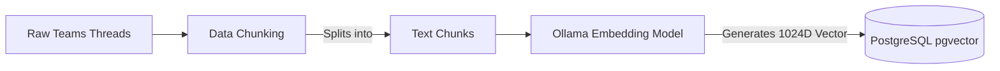
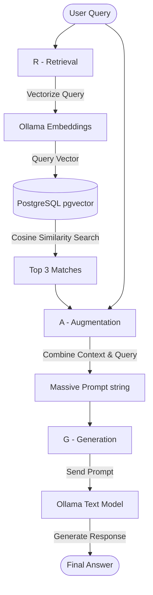

# Teams Knowledge Assistant

This project is a full-stack **Retrieval-Augmented Generation (RAG)** application. It allows users to search through historical discussion threads using **semantic similarity** (understanding the meaning of a question, rather than just matching exact keywords). 

## Getting Started

### 1. Environment Configuration
Create a `.env` file in the root directory. If you are running the Node.js backend locally (on your host machine) rather than inside Docker, configure it as follows:

```env
# Database connection (mapped from docker-compose port 5433)
DB_HOST=localhost
DB_PORT=5433
DB_NAME=teams_knowledge_db
DB_USER=teams_app
DB_PASSWORD=<your_db_password>

# Ollama connection (running via Docker on 11435)
OLLAMA_HOST=http://localhost:11435

EMBEDDING_MODEL=mxbai-embed-large
GENERATION_MODEL=qwen3:1.7b
```

### 2. Start Infrastructure
Run the database and Ollama containers in the background using Docker Compose:
```bash
docker compose up -d
```

### 3. Start Backend & Frontend
Start the Express backend (runs on port 5001):
```bash
cd backend
npm install
node index.js
```
Start the React frontend (runs on port 3000):
```bash
cd frontend
npm install
npm run start
```

---

Below is a detailed log of the project's development steps and an explanation of the core concepts used to build it.

---

## What We've Built (Step-by-Step History)

### Phase 1: Frontend UI & Styling
1. **Dashboard Layout**: Built a React-based UI layout using standard CSS Flexbox, ensuring the application utilizes the full page width.
2. **Component Creation**: Developed the left-hand Sidebar navigation, the main Search Bar area, an AI "Answer Synthesis" box, and cards for displaying "Related Conversations".
3. **Refining the Design**: Iteratively tweaked the UI based on specific preferences: adjusting font sizes up and down for readability, ensuring main content was strictly left-aligned, updating interactive elements (buttons, icons) to specific blue and green colors, and integrating `lucide-react` for scalable icons.

### Phase 2: Backend & Database Connectivity
4. **PostgreSQL Setup**: Configured a local PostgreSQL database running inside a Docker container, equipped with the `pgvector` extension for storing machine-learning vectors. Fixed a root volume mount issue that was preventing the Postgres 18 container from starting.
5. **Node.js Express Server**: Wired up the Express backend to communicate with the database. We successfully bypassed a common macOS conflict (where Apple's AirPlay Receiver occupies port 5000) by switching our backend to run on port `5001`.
6. **Data Ingestion**: Wrote and executed `importThreads.js`, which parsed a local JSON file containing mock Teams threads and safely upserted them into the `teams_threads` SQL table.

### Phase 3: The AI & Vector Pipeline
7. **Data Chunking**: Wrote and executed `chunkThreads.js` to process the raw threads into LLM-friendly text chunks (stored in `teams_thread_chunks`). *(See "Core Concepts" below for an explanation).*
8. **Embedding Generation**: Leveraged local AI via **Ollama**. We pulled the `mxbai-embed-large` embedding model and ran `embeddings.js` to mathematically convert our text chunks into 1024-dimensional vectors. 
9. **Semantic Search API**: Built a `/api/v1/knowledge/search` endpoint in Express. This endpoint takes a user's query, generates a vector for it on the fly, and uses PostgreSQL's vector cosine distance (`<=>`) operator to find the closest matching thread chunks.
10. **Frontend Integration**: Wired the UI's search button to the new endpoint, replacing the hardcoded dummy data with dynamic, real-time semantic search results mapped directly from the database.

### Phase 4: UX Enhancements & Realism
11. **Dynamic Answer Synthesis**: Updated the Answer Box to dynamically extract and display a clean, bulleted list of "remedies" (resolutions) from the top matching threads.
12. **Smooth Scrolling Navigation**: Made the source badges and text labels interactive. Clicking on a source (e.g., "Source 1") smoothly scrolls the page down to the exact matching conversation card.
13. **Teams-like Chat UI Modal**: Upgraded the backend `search.js` to return the full thread history (including timestamps and author names). Built a polished, React-based modal overlay in `App.jsx` that mimics the Microsoft Teams chat UI. Clicking "View source" now opens the full, unabridged discussion natively in the app.
14. **Realistic Mock Data Update**: Replaced the initial, repetitive mock data with highly realistic, multi-participant engineering troubleshooting conversations. We safely truncated the old database and re-ran the entire data pipeline (import → chunk → embed) to load this high-quality semantic data.

---

## Core Concepts: What and Why



### 1. Data Chunking
**What are we doing?** 
We take a massive block of text (like a long thread with 20 replies) and break it down into smaller, self-contained sections (chunks). We format these chunks cleanly (e.g., separating the Question, Replies, and Resolution).
**Why are we doing this?** 
AI models have a limited "context window" (how much text they can read at once) and can get distracted by irrelevant noise. If a user asks "How do I fix a 403 error?", we want the system to look at a small chunk of text that actually discusses 403 errors, rather than evaluating a massive 5-page thread where the 403 error was only mentioned once in passing. 
**Example**: Instead of feeding the database "Thread 12" as a massive essay, we feed it "Thread 12 - Part 1", "Thread 12 - Part 2", making it much easier to pinpoint exactly where the answer lives.

### 2. Embeddings (Vectorization)
**What are we doing?** 
We pass our text chunks into an AI model (`mxbai-embed-large`), which reads the text and spits out a **Vector**—a massive array of numbers (in our case, 1,024 numbers long). We save these numbers in our database using `pgvector`.
**Why are we doing this?** 
Computers don't understand words, but they are incredibly fast at calculating numbers. An embedding is basically a set of coordinates that plots the "meaning" of a sentence on a mathematical map. 
**Example**: If you search for "Cannot login", traditional database search looks for those exact words. It would fail to find a thread titled "Authentication failure". However, an embedding model plots "Cannot login" and "Authentication failure" right next to each other on its mathematical map because they mean the same thing. 

### 3. Semantic Similarity Search (Vector Search)
**What are we doing?** 
When a user types a query into the UI, we instantly convert their query into an embedding vector. We then ask PostgreSQL to calculate the distance between the query's vector and every chunk vector we have saved in the database.

**Where is this data saved?**
The embeddings are saved directly inside PostgreSQL in the `teams_thread_chunks` table, inside a special column named `embedding` (which uses the `vector(1024)` data type). This means the text chunks and their mathematical representations live side-by-side in the exact same row.

**How does the POST API Search process work under the hood?**
When the frontend sends a request to `POST /api/v1/knowledge/search`, the endpoint (`backend/src/search.js`) executes the following semantic logic:
1. **On-the-fly Embedding**: The API intercepts the text query and immediately calls the local Ollama model to generate a fresh 1024D vector specifically for that exact question.
2. **PostgreSQL Comparison**: The API then injects this new vector into a SQL query utilizing the `pgvector` extension.
3. **The `<=>` Operator**: We use `pgvector`'s special `<=>` operator, which calculates the **Cosine Distance** between the query's vector and the stored chunk's vector. 
4. **Scoring**: Because Cosine Distance measures how far apart they are, we subtract it from 1 (`1 - distance`) to calculate the **Cosine Similarity**. This gives us a percentage score (like `0.74` for a 74% match).
5. **Deduplication (`MAX` grouping)**: If a massive thread was broken into 12 chunks, we don't want to spam the search results with 3 chunks all from the exact same thread. The SQL query uses `GROUP BY thread_id` and `MAX(similarity)` to flatten the chunks down, ensuring a thread is only returned exactly *once* using the score of its highest-matching chunk.
6. **Threshold Filtering**: We enforce a strict `WHERE max_similarity >=50` filter. If the AI is only 64% confident (or less) that a thread is relevant, the database drops it completely, preventing unrelated hallucinated answers from showing up in the UI. The final top 3 remaining threads are then returned to the frontend!

### 4. How R.A.G. is Implemented in Code
RAG stands for **Retrieval-Augmented Generation**. Here is exactly where and how each step occurs in this project's codebase:



#### R - Retrieval (`backend/src/search.js`)
First, we **retrieve** the relevant information. We convert the user's query into an embedding vector, and ask the database to find the closest matching conversation chunks using vector similarity (`<=>`).

```javascript
// 1. Vectorize the user's query
const response = await fetch(`${ollamaUrl}/api/embeddings`, {
  method: 'POST',
  body: JSON.stringify({ model: 'mxbai-embed-large', prompt: query })
});
const queryEmbedding = `[${data.embedding.join(',')}]`;

// 2. Retrieve top matches from PostgreSQL using Vector Cosine Distance (<=>)
const sql = `
  WITH ranked_chunks AS (
      SELECT
          t.id,
          c.content,
          1 - (c.embedding <=> $1::vector) AS similarity,
          ROW_NUMBER() OVER (
              PARTITION BY t.id
              ORDER BY c.embedding <=> $1::vector
          ) AS chunk_rank
      FROM teams_thread_chunks c
      JOIN teams_threads t ON t.id = c.thread_id
      WHERE c.embedding IS NOT NULL
  )
  SELECT * FROM ranked_chunks 
  WHERE chunk_rank = 1 AND similarity >= $2 
  ORDER BY similarity DESC LIMIT 3;
`;
const result = await db.query(sql, [queryEmbedding, 0.50]);
const topThreads = result.rows; // This is our retrieved data!
```

#### A - Augmentation (`backend/src/generateAnswer.js`)
Once we have our retrieved data, we **augment** the user's question. This simply means we build a large text prompt that contains both the user's question *and* the text of the retrieved conversations, plus instructions on how to behave.

```javascript
// We take the retrieved database rows and format them into a single long string
const context = results
  .map((result, index) => {
    return `Source ${index + 1}\nThread: ${result.external_thread_id}\nConversation:\n${result.content}`;
  }).join("\n---\n");

// We build a massive prompt combining instructions, context, and the query
const prompt = `
You are a knowledge assistant for an engineering team.
Answer the user's question using only the source conversations provided below.

USER QUESTION:
${query}

SOURCE CONVERSATIONS:
${context}

ANSWER:
`.trim();
```

#### G - Generation (`backend/src/generateAnswer.js`)
Finally, we send our fully augmented prompt to the AI (Ollama) so it can read the context and **generate** a readable answer.

```javascript
// Send the massive augmented prompt to our generation model (e.g. qwen3:1.7b)
const response = await fetch(`${OLLAMA_HOST}/api/generate`, {
  method: "POST",
  headers: { "Content-Type": "application/json" },
  body: JSON.stringify({
    model: GENERATION_MODEL,
    prompt: prompt, // This contains the augmented instructions + context + query
    stream: false,
    options: {
      temperature: 0.2, // Low temperature for factual consistency
    },
  }),
});

const data = await response.json();
const answer = data.response; // The AI's generated answer!
```
